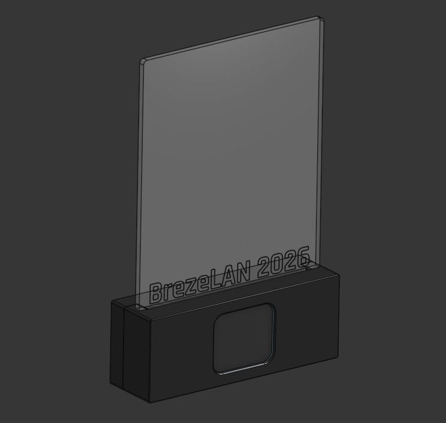

# BrezeLAN 2026 Trophy

This is a trophy based on ESPHome, including an art display with RGB lighting and a display that shows the ETA to the next LAN party.
The original BrezeLAN 2026 trophy sports a unique engraving on the art display that has been removed for copyright reasons.

## BOM
* ~70g of Filament, preferably black or CF/GF filled - must be opaque to prevent light bleeding. PLA is fine, use ABS/ASA for longevity
* 8x M3x4x5 heat set insert
* 4x M3x12 SHCS
* 2x M3x16 BHCS
* 2x M3x6 BHCS
* 4x M2x4 BHCS
* 12x M2 Washer
* 110x140 3mm Acrylic Sheet
* OPTIONAL: 4x small sticky rubber feet
* OPTIONAL: 4x 10mm ball bearing balls
* [ESP32-C3 Super Mini](https://www.amazon.de/dp/B0H3ZY3KC3)
* [1.69" IPS TFT with SPI](https://www.amazon.de/dp/B0HFHZY7Z3)
* ~100mm [5V WS2812 COB LED strip](https://www.amazon.de/dp/B0DG5RNZFF)
* 2-3m AWG28 wire - thin insulation, PTFE is perfect
* 2-3m USB-A to USB-C cable with USB2.0 data connection

The ESP32-C3 Super Mini is available from a variety of sources - just use the cheapest you find. The display is also widely available, but try and find the version with a notch for a seamless fit in the cutout. Use whatever 5V WS2812B style LED strip you can find. COB strips help with light uniformity.

## Preparation
### 3D printing
Print all three parts. Use supports for the USB-C cutout in the case backside.
Melt in the heat set inserts, make sure they are flush or the case won't assemble correctly.
Remove any burrs and leftovers from printing, especially around the display and the USB-C cutout. The display must not have any material pressing on it.

### CNC cutting
Add a non-copyrighted logo on the glass STEP and do the CAM work for your machine. Cut the glass on your CNC mill/router.

### LED strip
Cut your strip to length. It should be around 90mm long, but not exceed 100mm.
Stick the COB LED strip on the carrier, direction does not matter.

## Assembly
Take some time to lay out all the parts to see how they go together. Choose your wire length so you can comfortably assemble everything, but there's not too much slack that has to be stuffed inside the case.

### Soldering
Solder the display and the LED strip to the ESP32-C3 Super Mini using 28AWG wire. Use the following pins:

|  LCD | ESP32-C3 Super Mini  |
|---|---|
| GND | GND   |
| VCC  | 3.3V   |
| SCL  | GPIO7   |
| SDA  | GPIO8   |
| RES  | GPIO9   |
| DC  | GPIO10   |
| CS | GPIO6   |
| BLK   | GPIO20         |

|LED strip   | ESP32-C3 Super Mini   |
|---|---|
| GND  | GND   |
| 5V  | 5V   |
| Data    | GPIO5      |

Solder all wires so they stick out from the populated side of the ESP32-C3 Super Mini and the backside of the display. You can swap GPIO, but you'll have to change them in the esphome config before building the firmware.

### Display
Mount the display in the front part of the case. Be very careful: use the M2x4 fasteners and two or more washers, depending on their thickness, to prevent the fastener bottoming out and deforming the hole - which would be visible from the front.

### ESP32-C3 Super Mini
Slide the ESP32-C3 Super Mini most of the way into the cutout in the front case. It will get pressed into its final position during assembly of the backside.

### LED strip
Mount the LED strip holder with the M3x16 fasteners. Carefully route the wires so nothing gets pinched or is in the way during assembly of the case.
Slide the glass into the cutout and hold it in place while using the M3x6 fasteners to mount it to the case front.

### Finish up
Clip the optional 10mm ball bearing balls into the case back. They provide some weight so the trophy does not topple.

Mount the case back on the front. Start with aligning the ESP32-C3 Super Mini so it slides into the corresponding cutout on the case back. Then push it on the front. Aligning the USB-C port and the cutout might require some jiggling/guiding/expanding the cutout - it's a tight fit.

Use the M3x12 fasteners to mount the case back to the front.

Stick the optional rubber feet to the case bottom.

You're done!

## ESPHome
Create a device configuration using one of the existing YAML files, changing the `devicename` and `friendly_name`. Create a `secrets.yaml` in the `includes` directory with your Wi-Fi credentials.

Plug in the trophy with a USB cable and run esphome with e.g. `esphome run --device /dev/ttyACM0 $yourconfig.yml`. You'll need ESPHome 2026.10 or newer.

## Integration
The trophy uses ESPHome but can be used independently if no e.g. HomeAssistant installation is present, for those purposes the API reboot timeout has been removed.

### Improv BLE/Serial
To provision the trophy with new Wi-Fi credentials you can use Improv via BLE or serial, with serial being easily accessible using any computer with a WebUSB capable browser. Connect the trophy to your PC using a USB cable. A serial/JTAG should appear, no drivers are required.

Open up the Improv [website](https://www.improv-wifi.com/) and click "Connect device to Wi-Fi", then follow the instructions. The trophy also display a QR code with a link to this website when it can't connect to a Wi-Fi network.

### Web Interface
The trophy will display its hostname during startup - it uses `devicename` as its hostname for DHCP. Depending on your network configuration it should be enough to open `$devicename.local` in your browser.

### Home Assistant API
The trophy can be used in HomeAssistant via the esphome integration. Once the esphome integration is activated, depending on your network configuration, the device should be automatically discovered using mDNS or has to be manually added using its IP address or hostname.

## Functionality

### Stealth Mode
Stealth mode turns off all lighting at 22:00 and turns it back on at 08:00.

### Global Power
Global power directly turns off/on all lighting. This is useful for home automation purposes i.e. if you control your room lighting via Homeassistant and want to include the trophy.

### Art color
Changes the light color and brightness of the glass art. The art color can only be controlled via the Home Assistant API, the web interface GUI does not support setting colors.

### Text color
Changes the text color of the display. The text color can only be controlled via the Home Assistant API, the web interface GUI does not support setting colors.
